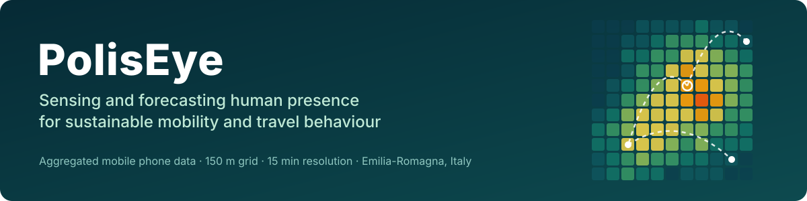
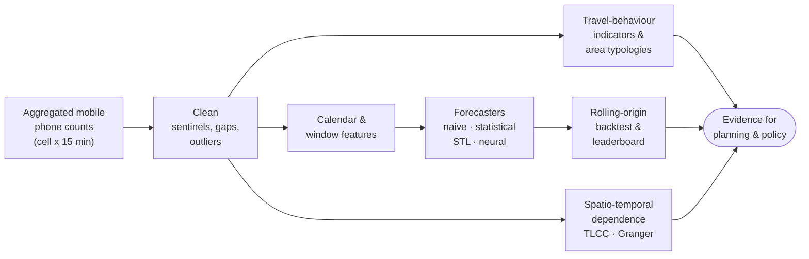
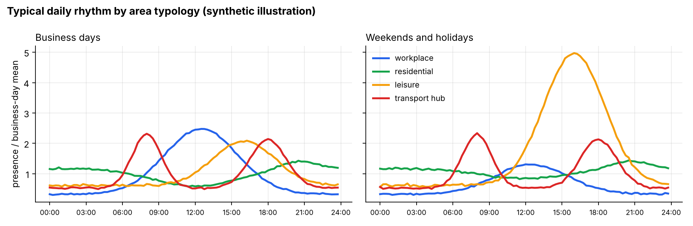

<p align="center">
  
</p>

<p align="center">
  <a href="https://github.com/alketcecaj12/PolisEye_Experimentation/actions/workflows/ci.yml"></a>
  
  <a href="https://doi.org/10.3390/app10186580"></a>
  <a href="https://doi.org/10.1109/ISC255366.2022.9922095"></a>
  <a href="https://www.poliseye.it/"></a>
</p>

<p align="center">
  <b>Where are people, when, and why?</b><br>
  A Python toolkit and research notebooks for turning aggregated mobile phone data into
  evidence about human presence, travel demand and the rhythms of urban places.
</p>

---

## Why this matters for sustainable mobility

Every trip leaves a footprint in space and time: people arrive somewhere, stay, and leave.
Aggregated mobile phone data record that footprint for every 150 m cell of a city, every
15 minutes, for everyone carrying a phone, without the cost or the sampling limits of a
travel survey. PolisEye uses it to support decisions that sit at the heart of sustainable
travel behaviour:

| Policy challenge | What PolisEye measures |
|---|---|
| **Congestion and peak spreading** | When each area peaks, how "peaky" demand is (`peak_to_base`), and how well short-term crowding can be forecast |
| **Land use and travel** | Functional *area typologies* (workplace, residential, leisure, transport hub) learned from weekly rhythms, linking the built environment to when people travel there |
| **Green transition** | Demand forecasts that public transport, shared mobility and visitor management can be planned around, instead of sizing for the worst case |
| **Tourism and overcrowding** | Departures from the typical rhythm (`anomaly_scores`) that flag events and tourist peaks in sensitive places |
| **Evidence for public authorities** | Transparent baselines, rolling-origin backtests and per-cell error maps that policymakers can trust and audit |

## The research, step by step

The work follows the scientific method end to end.

| Step | In PolisEye |
|---|---|
| **1. Observation** | Mobile phone presence in two grids in Emilia-Romagna (Modena city centre, 5 km², and Bologna airport, 2.5 km²) shows strong, repeating daily and weekly rhythms that differ from cell to cell. |
| **2. Question** | Can we forecast how many people will be in each part of a city in the next minutes to hours, and which methods work best for thousands of very different cells? What do those rhythms tell us about how places are used? |
| **3. Hypothesis** | Presence is dominated by daily and weekly seasonality plus calendar effects; methods that model this structure (decomposition, seasonal statistics, neural networks with long input windows) should beat naive baselines, with different trade-offs in accuracy, worst-case error and effort. |
| **4. Experiment** | 100+ notebooks compare naive, statistical (AR, ARIMA, SARIMA, Holt-Winters, VAR, Prophet) and deep learning (MLP, CNN, LSTM, CNN-LSTM, encoder-decoder) forecasters for 1-step and multi-step horizons, with and without STL decomposition, on univariate and multivariate series, across all cells. Spatio-temporal analyses (cross-correlation, Granger causality) probe how cells influence each other. |
| **5. Analysis and conclusion** | No single winner. Statistical models are the most precise when tuned per cell, but need domain knowledge and expensive grid searches. Deep learning is simpler to deploy across thousands of heterogeneous cells and reduces the maximum error ([Cecaj et al., 2020](https://doi.org/10.3390/app10186580)). This package turns those lessons into reusable, tested tools. |

## Pipeline



<p align="center">
  
</p>

## Quickstart

```bash
git clone https://github.com/alketcecaj12/PolisEye_Experimentation.git
cd PolisEye_Experimentation
pip install -e ".[dev]"     # core + tests;  add ,viz / ,deep / ,geo / ,notebooks as needed
poliseye demo               # runs on built-in synthetic data, no download needed
```

```text
          mean_presence peak_time  peak_to_base  am_pm_ratio  weekday_weekend  night_share    cv activity_level       typology
cell
486-1258         109.51     12:30          8.20         1.28             1.57         0.10  0.80           high      workplace
488-1264         172.10     20:30          2.47         0.80             0.92         0.28  0.23      very_high    residential
490-1254          59.85     16:15          3.61         0.34             0.57         0.12  0.91         medium        leisure
495-1266         102.39     08:00          4.69         1.05             1.00         0.14  0.58           high  transport hub

Rolling-origin benchmark, horizon 4 x 15 min, 7 origins

                          MAE   RMSE   MAPE  MaxAE  rank
model
weekday x slot profile   5.62   6.64   6.93  10.23     1
seasonal naive (1 day)   6.40   7.54   7.29  11.64     2
persistence             15.71  17.43  16.13  25.07     3
same slot, last 4 days  18.10  18.94  17.32  23.63     4
```

Run it on your own data (either the operator's raw export or the processed
`date, cell_num, nr_people, hours, minutes` layout):

```bash
poliseye profile   my_presence.csv
poliseye benchmark my_presence.csv --horizon 16 --statistical
```

### From Python

```python
from poliseye import (
    load_presence, to_wide, clean_presence,
    mobility_indicators, area_typologies,
    compare_models, DayHourProfileForecaster, SeasonalNaiveForecaster,
)
from poliseye.backtest import leaderboard
from poliseye.decomposition import STLForecaster
from poliseye.statistical import ARIMAForecaster

wide = clean_presence(to_wide(load_presence("my_presence.csv")), cap=4500)

# How are places used?
indicators = mobility_indicators(wide)        # peak time, peak-to-base, weekday/weekend, ...
typologies = area_typologies(wide, n_types=4)  # workplace / residential / leisure / hub

# How well can we forecast the next 4 hours?
results = compare_models(
    wide,
    {
        "weekday x slot profile": DayHourProfileForecaster,
        "seasonal naive": SeasonalNaiveForecaster,
        # weekly STL season (672 slots) + AR(1) on the seasonally adjusted series
        "STL + AR": lambda: STLForecaster(ARIMAForecaster((1, 0, 0), trend="c"), period=672),
    },
    horizon=16,
    n_origins=10,
)
print(leaderboard(results, metric="MAE"))
```

## What is in the package

| Module | Purpose | Ported from |
|---|---|---|
| `poliseye.data` | Load raw or processed files, pivot to a `time x cell` grid, fill gaps, cap outliers, read stored error files, generate synthetic data | `EDA/FixData.ipynb` |
| `poliseye.timefeatures` | Business days and public holidays for any year (Italian built in, any custom calendar accepted) | `EDA/ExplorativeDataAnalysis_*.ipynb` |
| `poliseye.windows` | `split_sequence` / `split_sequences` / lag features for supervised learning | 70+ notebook cells |
| `poliseye.metrics` | MAE, RMSE, MAPE, MaxAE | all comparison notebooks |
| `poliseye.baselines` | Persistence, seasonal naive, moving average, weekday x slot profile | `StatisticalModels/NaiveMethods` |
| `poliseye.statistical` | ARIMA / SARIMA / Holt-Winters with a modern `statsmodels` API and grid search | `legacy_scripts/Best*.py` |
| `poliseye.decomposition` | STL decomposition and decomposition-based forecasting around any model | `*_with_STL_Decomposition*.ipynb` |
| `poliseye.backtest` | Rolling-origin evaluation, multi-cell comparison, leaderboard | `Confronto`, `DataViz_ConfrontoMetodi` |
| `poliseye.spatial` | Correlation matrices, time-lagged and windowed cross-correlation, Granger causality | `SpatioTemporalCA` |
| `poliseye.mobility` | Daily profiles, travel-behaviour indicators, activity levels, area typologies, anomaly scores | `Classifica_celle_*.ipynb`, new |
| `poliseye.deep` | Optional MLP / CNN / LSTM forecasters with the same interface (`pip install -e ".[deep]"`) | `DeepLearningModels` |

Every forecaster has the same two methods, `fit(history)` and `predict(horizon)`, so any
model, including your own, drops into the backtesting tools.

## Repository layout

```text
PolisEye_Experimentation/
├── src/poliseye/          # the Python package
├── tests/                 # pytest suite (runs on synthetic data, no private data needed)
├── notebooks/             # the original research notebooks, unchanged (see notebooks/README.md)
│   ├── EDA/                       data cleaning, exploration, decomposition, hourly maps
│   ├── StatisticalModels/         naive, AR, ARIMA, SARIMA, ETS, VAR
│   ├── DeepLearningModels/        MLP, CNN, LSTM, hybrids (uni/multivariate, 1-step/multi-step)
│   ├── Prophet/                   Prophet with and without STL decomposition
│   ├── Confronto/                 head-to-head method comparisons
│   ├── DataViz_ConfrontoMetodi/   error comparison plots
│   ├── SpatioTemporalCA/          correlation and causality between cells
│   └── legacy_scripts/            original grid-search scripts
├── examples/              # scripts that regenerate the figures
├── docs/assets/           # banner and figures
└── pyproject.toml
```

## Data and privacy

The mobile phone data were provided by the operator in aggregated form only: each value
counts the phones in a cell during a 15-minute slot, with no reference to individuals,
in line with the GDPR. The raw data are **not redistributable** and are not included.
Stored per-cell forecast errors produced by the notebooks are kept next to them, and the
package and its tests run on a realistic synthetic generator
(`poliseye.synthetic_presence`).

## Where this goes next

The same tools open directly onto questions in travel behaviour research:

- **Fusing passive and survey data.** Combine phone-based presence with national travel
  surveys and register data to scale survey-based behaviour models in space and time.
- **Land use and travel.** Relate area typologies to land-use mix, density and access to
  public transport, in large cities and in rural settings.
- **Evaluating policies.** Use forecasts as counterfactuals to measure how interventions
  (pricing, new lines, car-free zones, events) change when and where people travel.
- **Mobility for all.** Compare rhythms across neighbourhoods to reveal unequal access and
  times of day that are poorly served.
- **Decision support.** Package forecasts and indicators as operational dashboards for
  public authorities, as in the POLIS-EYE platform.

## Publications

- A. Cecaj, M. Lippi, M. Mamei, F. Zambonelli. **Comparing deep learning and statistical methods in forecasting crowd distribution from aggregated mobile phone data.** *Applied Sciences* 10(18):6580, 2020. [doi:10.3390/app10186580](https://doi.org/10.3390/app10186580)
- A. Cecaj, M. Lippi, M. Mamei, F. Zambonelli. **Sensing and forecasting crowd distribution in smart cities: potentials and approaches.** *IoT* 2(1):33–49, 2021. [doi:10.3390/iot2010003](https://doi.org/10.3390/iot2010003)
- A. Cecaj, M. Lippi, M. Mamei, F. Zambonelli. **Forecasting crowd distribution in smart cities.** IEEE SECON Workshops, 2020. [doi:10.1109/SECONWorkshops50264.2020.9149774](https://doi.org/10.1109/SECONWorkshops50264.2020.9149774)
- A. Seravalli et al. (incl. A. Cecaj). **Towards smart cities for tourism: the POLIS-EYE project.** IEEE International Smart Cities Conference (ISC2), 2022. [doi:10.1109/ISC255366.2022.9922095](https://doi.org/10.1109/ISC255366.2022.9922095)
- A. Cecaj, M. Mamei. **Data fusion for city life event detection.** *Journal of Ambient Intelligence and Humanized Computing* 8(1):117–131, 2017. [doi:10.1007/s12652-016-0354-7](https://doi.org/10.1007/s12652-016-0354-7)

```bibtex
@article{cecaj2020comparing,
  title   = {Comparing Deep Learning and Statistical Methods in Forecasting Crowd
             Distribution from Aggregated Mobile Phone Data},
  author  = {Cecaj, Alket and Lippi, Marco and Mamei, Marco and Zambonelli, Franco},
  journal = {Applied Sciences},
  volume  = {10},
  number  = {18},
  pages   = {6580},
  year    = {2020},
  doi     = {10.3390/app10186580}
}
```

## About the project

**POLIS-EYE** (*POLIcy Support systEm for smart citY data governancE*) is an industrial
research project funded by the Emilia-Romagna Region under POR FESR 2014-2020. It built
decision-support tools that help public managers monitor and forecast people's presence
in tourist areas, combining heterogeneous datasets with a focus on mobile phone network
data. Partners included GeoSmart Lab (Sis.Ter, coordinator), ENEA, the University of
Bologna, the University of Ferrara and the University of Modena and Reggio Emilia
(AIRI, Artificial Intelligence Research and Innovation Center), where this code was
developed. More at [poliseye.it](https://www.poliseye.it/).

**Author:** Alket Cecaj · [GitHub](https://github.com/alketcecaj12)
